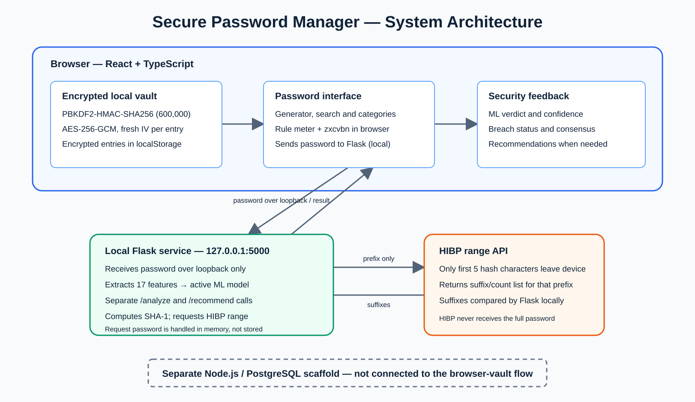

# Secure Password Manager

Browser-local password-manager prototype with encrypted vault storage, password-strength analysis, breach checking, and recommendations.

> Academic project only. This is not an audited production password manager. Do not use real credentials during a demonstration.

## Project highlights

- Browser vault encrypted with AES-256-GCM; keys are derived using PBKDF2-HMAC-SHA256 with a random salt and 600,000 iterations.
- Password generator, search, categories, and automatic locking.
- Browser-side rule meter and zxcvbn feedback.
- Optional loopback-only Flask service for Random Forest analysis and recommendations.
- HIBP Pwned Passwords range lookup: only a five-character SHA-1 prefix is sent to HIBP.

## System architecture

During analysis, the browser sends the password in plaintext over loopback to the local Flask service on the same computer; the service handles the request in memory and does not store the password. Flask sends only a five-character SHA-1 prefix to HIBP, receives the suffix/count list for that prefix, and checks it locally. Analysis and recommendation use separate API calls. The Node.js/PostgreSQL scaffold remains separate from the browser-vault flow.



## Results

All values below use the same clean, balanced test set of 15,000 labelled passwords (5,000 per class). They measure agreement with source-derived labels and are not estimates of real-world crack time.

| Method | Accuracy | Macro-F1 |
|---|---:|---:|
| Rule meter | 69.42% | 62.91% |
| zxcvbn | 84.81% | 84.65% |
| Random Forest | **94.05%** | **94.00%** |
| XGBoost | 89.65% | 89.40% |

The local service uses Random Forest because it achieved the strongest macro-F1 on this common evaluation set.

## Repository layout

```text
existing-approach/
  client/                         React + TypeScript browser vault
  server/                         Separate Express/PostgreSQL scaffold (not integrated)
proposed-improvement/
  ml-model/                       Feature extraction, training, evaluation, Flask API
  hibp-integration/               HIBP range-lookup utility
  argon2-benchmark/               Standalone PBKDF2 vs Argon2id timing experiment
datasets/README.md                Dataset acquisition and handling notes
report/                           Report source, figures, and editable Draw.io diagrams
output/pdf/                       Final academic report PDF
```

Raw password datasets, local evaluation files, archived training runs, and build caches are intentionally ignored. See [datasets/README.md](datasets/README.md) for approved data sources and Kaggle reproduction steps.

## Run locally

### 1. Start the ML service

```powershell
cd proposed-improvement/ml-model
python -m pip install -r requirements.txt
python serve_model.py
```

Check `http://127.0.0.1:5000/health`; `model_loaded` should be `true`.

### 2. Start the browser client

```powershell
cd existing-approach/client
npm install
npm run dev
```

Open `http://localhost:5173`, create a local demo vault, and use synthetic credentials only.

## Security notes

- Vault data is local to the browser profile. Clearing site data removes it.
- The local ML service receives a password in plaintext over loopback only; never expose it to a network.
- HIBP no-match results do not prove a password has never been exposed.
- The Node/PostgreSQL scaffold is not part of the current browser-vault flow.
- The Argon2id script is a benchmark only; the implemented vault uses PBKDF2.

## Report

[Read the academic report](output/pdf/secure_password_manager_project_report.pdf). It documents the selected baseline, limitations, proposed approach, evaluation protocol, and results.

## Reference

M. Kanjikar et al., "Password Manager," *International Journal for Research in Applied Science & Engineering Technology*, vol. 13, issue XII, 2025. DOI: [10.22214/ijraset.2025.76363](https://doi.org/10.22214/ijraset.2025.76363).
