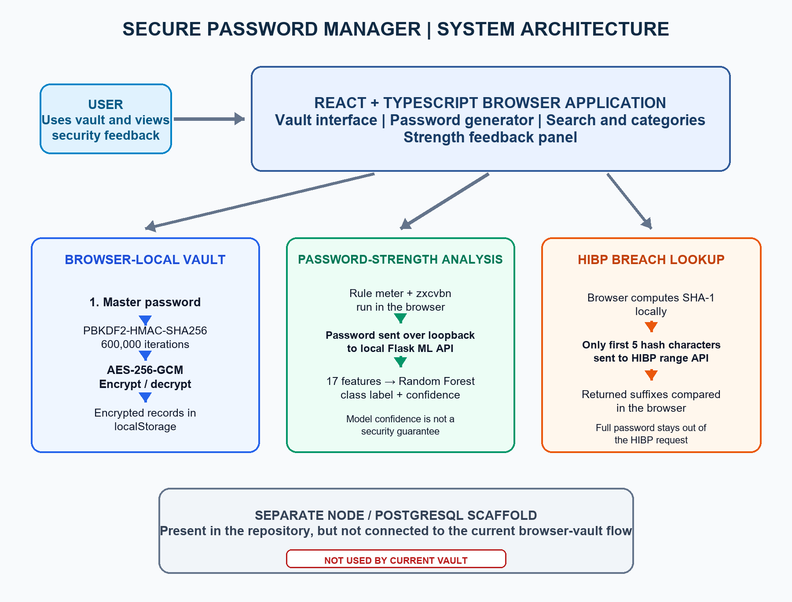
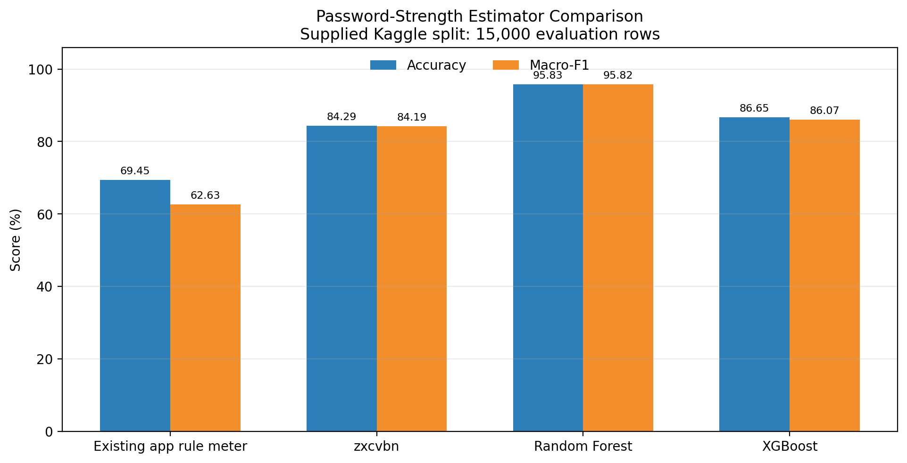

# Secure Password Manager with Password-Strength and Breach-Exposure Analysis

**Application-based cybersecurity project report**

**Project members**

1. **Vujja Punith Sai** — Roll No. **S20240010260**
2. **Voorkonda Shivamani Kumar Reddy** — Roll No. **S20240010259**

**Department:** Computer Science and Engineering (CSE)  
**Institution:** IIIT Sri City  
**Course:** CSE

## Abstract

This project implements a browser-based password-manager prototype and evaluates an added password-strength classification feature. The application encrypts vault entries in the browser with AES-256-GCM, derives the encryption key from a master password with PBKDF2-HMAC-SHA256, generates passwords, organizes entries by category, supports search, and locks after inactivity. It also displays the existing rule-based meter and zxcvbn estimate, calls a local Random Forest or XGBoost inference service, and checks password exposure through the Have I Been Pwned (HIBP) range API.

The application-level reference is Kanjikar et al., “Password Manager,” published in IJRASET in December 2025. The paper describes a password-manager design and mentions strength analysis, but does not specify a strength algorithm or report classifier accuracy or F1. Accordingly, this project does not claim to reproduce a paper classifier or to beat paper-reported scores. In the supplied Kaggle run, Random Forest reached 95.83% accuracy and 95.82% macro-F1 on a 15,000-row held-out, source-labelled evaluation set, ahead of the rule meter, zxcvbn, and XGBoost in that run. These numbers measure agreement with the chosen labels and split; they are not estimates of real-world crack resistance. The repository is a class prototype, not an audited production password manager.

## 1. Introduction

### 1.1 Background and motivation

People use many online accounts, and remembering a distinct, strong password for each one is difficult. Reuse and easily guessed passwords expose accounts to credential stuffing and other attacks. A password manager can help by storing credentials in an encrypted vault and generating passwords for users.

Encryption alone does not tell a user whether a password is commonly used or appears in known breach data. This project focuses on a password manager that combines local vault protection with password-strength feedback and a breach-exposure lookup.

### 1.2 Cybersecurity importance

Passwords protect access to personal, educational, and financial services. A manager must protect stored credentials, limit exposure while the vault is unlocked, and give users accurate, understandable feedback. Strength indicators are estimates, not guarantees; breach-list checks cover only the data available to that service.

### 1.3 Problem statement

The selected paper describes a password manager with a strength-analysis feature, but does not specify how strength is computed or provide a quantitative evaluation. The repository’s simple rule meter has limited pattern awareness, and the application has no built-in breach exposure lookup in the paper’s described design. The project therefore implements and compares additional strength estimators and adds a HIBP range lookup to the password-manager prototype.

### 1.4 Objectives

1. Study the supplied base paper and identify the approach and evidence it actually reports.
2. Implement and demonstrate a password-manager application with encrypted browser storage.
3. Compare the application’s rule meter and zxcvbn with Random Forest and XGBoost on the supplied dataset experiment.
4. Add HIBP range checking while sending only a truncated SHA-1 hash prefix to HIBP.
5. Document the experimental setup, results, security boundaries, and limitations accurately.

## 2. Overview of the Existing Article / Technique

### 2.1 Base paper

The selected article is Mahesh Kanjikar, Ashwini Yekkele, Divya Wale, Nandini Sharma, and Nikita Wadikar, “Password Manager,” *International Journal for Research in Applied Science & Engineering Technology (IJRASET)*, Volume 13, Issue XII, December 2025, pages 1492–1498, DOI [10.22214/ijraset.2025.76363](https://doi.org/10.22214/ijraset.2025.76363). The complete supplied PDF is nine pages.

The article’s abstract and main text describe a web password manager using a master password, AES-256, PBKDF2, a React frontend, a Node.js/TypeScript backend, and PostgreSQL. Described features include password generation, strength analysis, categories, search, auto-lock, and import/export. The methodology discusses client-side encryption, backend APIs, encrypted database records, testing, and deployment. Its future-work section mentions machine learning as a possible way to analyze weak passwords or suspicious activity.

The paper does **not** specify the algorithm used by its strength-analysis feature, publish a trained strength classifier, name training datasets, or report accuracy, macro-F1, or other quantitative classifier results. It therefore provides no paper classifier score that this project can reproduce. The paper also contains a technology-stack inconsistency: its abstract and methodology describe React/Node.js/PostgreSQL, while its conclusion describes Python with Flask/FastAPI and SQLite/MySQL. This report records that discrepancy instead of treating one stack as confirmed.

### 2.2 Working methodology described in the paper

At a high level, the paper proposes that a user unlocks a vault using a master password; a key derived using PBKDF2 protects credentials encrypted using AES-256; an application frontend manages entries and communicates with a backend; the database stores encrypted data; and password generation, strength feedback, categories, search, and inactivity locking support safer use. The paper lists unit, integration, end-to-end, security, and performance testing, but does not provide corresponding quantitative results in the supplied article.

### 2.3 Advantages and applications

The described design addresses password reuse, weak password selection, and unsafe credential storage. A single master password can replace the need to remember every account password; generated passwords, organization, and automatic locking can improve day-to-day safety and usability.

## 3. Implementation of the Existing Approach

### 3.1 Existing-approach baseline in this repository

The repository contains a React and TypeScript browser application that implements part of the paper’s password-manager concept. It is a project implementation inspired by the article; the supplied paper does not provide the original source code or an artifact for a code-for-code reproduction.

| Paper-described capability | Implementation status in this repository |
|---|---|
| Master-password-protected vault | Implemented in the browser; PBKDF2 derives the encryption key |
| AES-256 encrypted credentials | Implemented with Web Crypto AES-GCM (authenticated encryption) |
| Password generation | Implemented with browser cryptographic randomness |
| Categories and search | Implemented |
| Auto-lock | Implemented after five minutes of inactivity |
| Password-strength feedback | Existing rule meter is implemented; the paper does not define its own algorithm |
| Import/export and backup | Not implemented in the current browser vault |
| Favorites | A star icon is displayed but does not implement favorite behavior |
| Node/PostgreSQL storage and synchronization | Server scaffold exists separately; the current browser vault does not use it |

The existing application baseline for the experiment is its rule-based meter. zxcvbn is an additional established comparator used by this project; it is not attributed to the paper.

### 3.2 Tools and technologies

- Frontend: React 18, TypeScript, Vite, and Tailwind CSS.
- Browser cryptography: Web Crypto API, AES-256-GCM, and PBKDF2-HMAC-SHA256.
- Vault persistence: encrypted records in browser localStorage.
- Strength evaluation: project rule meter, zxcvbn, and a Python/Flask model service.
- Breach check: HIBP Pwned Passwords range API using five-character SHA-1 prefixes.
- Experiment: Kaggle notebook, pandas, NumPy, scikit-learn, XGBoost, joblib, and zxcvbn.
- Separate backend scaffold: Node.js/Express and PostgreSQL; it is not integrated with the current browser vault flow.

### 3.3 Existing application workflow

1. The user enters a master password.
2. The browser derives an AES-256-GCM key using PBKDF2-HMAC-SHA256 with a random 16-byte salt and 600,000 iterations.
3. Vault entries are encrypted in the browser with a fresh random 12-byte IV per encryption and stored in localStorage.
4. After unlock, the user can add, view, copy, search, categorize, and delete credentials; a five-minute inactivity timer locks the vault.

The application is browser-local. It does not currently authenticate against or store vault data in the separate PostgreSQL scaffold.

## 4. Challenges and Limitations

The paper mentions strength analysis but leaves the algorithm and performance unspecified. This prevents a direct algorithm-level replication or numerical comparison with the paper. Its broad feature description also does not itself provide an independently reproducible implementation in the supplied PDF.

The repository’s rule meter uses length and character classes, so it may miss common words, predictable substitutions, repetition, and other patterns. zxcvbn gives a richer estimate but is still an estimator. Neither a strength label nor a high model confidence guarantees that a password is unguessable.

Other relevant limitations are:

- The browser vault stores ciphertext in localStorage; scripts executing in the same origin may access browser storage, and XSS can undermine a vault while unlocked.
- The local ML endpoint receives the password as plaintext over loopback for inference. The service must stay bound to 127.0.0.1 and should be used with fake demo inputs.
- HIBP checks only its available corpus. An unavailable lookup is not evidence that a password is safe.
- The frontend is not connected to the repository’s Node/PostgreSQL scaffold. There is no verified server-side sync or database persistence in the current vault flow.
- The project has no completed import/export recovery flow; clearing browser data can lose the vault.
- The ML dataset labels are inherited from a labeled dataset or inferred from membership in common-password lists. They are not independent measurements of attacker guessability.
- Selecting the “best” of RF and XGBoost by the same reported evaluation scores makes the winning-model comparison optimistic. The reported comparison should be treated as a preliminary experiment until model selection is done on a validation split and the final test set remains untouched.

## 5. Proposed Approach

### 5.1 Proposed improvement

The project adds data-driven password-strength classification and breach-exposure feedback to the browser password manager. The ML prediction complements the rule meter and zxcvbn; it does not replace encryption, establish password safety, or claim to be the paper’s original algorithm. The HIBP lookup adds an exposure signal that the paper does not describe.

### 5.2 Model and features

The Kaggle notebook trains Random Forest and XGBoost classifiers for three classes: weak, medium, and strong. It extracts 17 features: length, character entropy, upper/lowercase/digit/symbol counts and ratios, unique-character count and ratio, sequential patterns, repeated adjacent characters, character-class transitions, dictionary membership, and common year/numeric patterns.

The repository’s local Flask service loads the packaged model and the matching feature order and dictionary. In the current installed bundle, Random Forest is the selected model. The project UI sends a password to the local service only for this optional prediction.

### 5.3 Breach-check workflow

The browser computes the password’s SHA-1 hash locally, sends only its first five hexadecimal characters to the HIBP range endpoint, and compares the returned suffixes in the browser. HIBP never receives the full password from this check. This is a k-anonymity range lookup, not a guarantee that an unmatched password has never been exposed.

### 5.4 Architecture

Figure 1 shows the implemented browser-vault flow and the two external checks. The Node/PostgreSQL scaffold is included separately to make clear that the current vault does not connect to it.

**Figure 1.** System architecture of the implemented prototype.

## 6. Implementation of the Proposed Approach

### 6.1 Dataset sources and preparation

The notebook uses the four datasets selected by the project owner:

| Kaggle input | Use in this experiment |
|---|---|
| [Password Strength Classifier Dataset](https://www.kaggle.com/datasets/bhavikbb/password-strength-classifier-dataset) | Supplies dataset-labelled password examples |
| [Common Password List (RockYou)](https://www.kaggle.com/datasets/wjburns/common-password-list-rockyoutxt) | Common-password entries treated as weak examples |
| [10,000 Most Common Passwords](https://www.kaggle.com/datasets/shivamb/10000-most-common-passwords) | Common-password entries treated as weak examples |
| [Top 10 Million Passwords](https://www.kaggle.com/datasets/joebeachcapital/top-10-million-passwords) | Common-password entries treated as weak examples; the Kaggle source is a SecLists list, not the Xato dataset |

The notebook records seed 42, selects at most 100,000 training rows per class, and generated 300,000 balanced training rows in the supplied run. It evaluated 15,000 rows, sampled as 5,000 per class. The held-out weak examples came from a partition of the common-password lists; medium and strong evaluation examples came from held-out rows in the labeled CSV. The weak-list test partition was excluded from training and from the training dictionary. The notebook generated 50,000 random strong examples for the training pool; this does not mean the test set consists of generated passwords.

The weak label for common-list entries is assigned by source membership. The CSV labels are accepted as provided. Therefore, the evaluation measures agreement with these labels and this sampling protocol; it does not measure empirical crack time or represent a universal definition of password strength.

### 6.2 Training and app integration

The notebook extracts the 17 features and trains a Random Forest with 300 trees and an XGBoost classifier with 350 estimators. It saves checkpoints during preparation, training, evaluation, and packaging. The packaged model bundle contains model artifacts, feature order, training metadata, comparison metrics, and a matching dictionary. The dictionary is sensitive password-derived data and is kept out of public Git.

The Flask API serves the selected model locally. The browser strength panel displays the rule meter, zxcvbn, ML result, and HIBP status separately. The Node/PostgreSQL scaffold remains a separate component and is not described as the browser vault backend.

### 6.3 Experimental setup and metrics

The reported comparison uses accuracy and macro-F1. Accuracy is the fraction of correct predictions. Macro-F1 is the unweighted average of the per-class F1 scores, so each class contributes equally. Results below are taken from the supplied Kaggle ZIP’s model_comparison.csv; they are not measurements reported in the base paper.

## 7. Results and Analysis

### 7.1 Password-strength model comparison

| Method | Accuracy (%) | Macro-F1 (%) |
|---|---:|---:|
| Existing app rule meter | 69.45 | 62.63 |
| zxcvbn | 84.29 | 84.19 |
| Random Forest | **95.83** | **95.82** |
| XGBoost | 86.65 | 86.07 |

In this supplied run, Random Forest exceeds the app’s rule meter by 26.39 percentage points in accuracy and 33.19 points in macro-F1. It exceeds zxcvbn by 11.54 accuracy points and 11.63 macro-F1 points. XGBoost is lower than Random Forest on both reported measures. These are differences within this experiment and split, not improvements over the base paper.

The supplied CSV contains summary metrics only; per-class precision/recall/F1 values are not included in that artifact and are not reconstructed here. A fresh Kaggle run should archive the notebook outputs, per-class classification reports, confusion matrices, source counts, and the test metrics together.

### 7.2 Interpretation and validity

The result shows that the Random Forest fit the chosen source-derived task better than the other compared methods on this evaluation set. It does not establish that the model is more accurate for real users, better at predicting attacker guesses, or more secure than mature password managers. The classes are balanced in the sampled evaluation, so the table is not a measure of performance under real-world password prevalence. Furthermore, the notebook compares model scores on the same evaluation set used to select the package’s best model. A validation set and a final untouched test set are needed before making a stronger generalization claim.

### 7.3 Other measured result

A local CPU derivation benchmark is included as a separate experiment. On the recorded Windows 11 / Intel system, the median for PBKDF2-HMAC-SHA256 at 600,000 iterations was 368.45 ms over 10 measured runs after one warm-up. The median for Argon2id at 65,536 KiB, t=3, p=1 was 190.27 ms. These settings are not equivalent-work configurations and the benchmark does not measure GPU cracking. The browser vault still uses PBKDF2; Argon2id is benchmark-only.

### 7.4 Application startup and local API verification

The frontend TypeScript/Vite production build completed successfully. Vite served the app entry page with HTTP 200. The Flask health endpoint reported the Random Forest model loaded, 17 features, and 453,429 dictionary entries. A synthetic demo password sent through the Vite proxy returned a Random Forest prediction (strong) with 1.0 model confidence. Confidence is the classifier's probability output for that input, not a guarantee of password security.

The build reported a JavaScript bundle of about 985 kB before gzip and warned that it exceeds Vite's 500 kB chunk-size advisory. The browser add/save/reopen/auto-lock interaction and a live HIBP network lookup remain in the manual demonstration checklist; they are not claimed as verified by this startup/API check.

## 8. Conclusion

This project implements a browser-based Secure Password Manager prototype and adds two password-risk feedback features: an ML strength estimate and a HIBP exposure lookup. It uses the IJRASET 2025 paper as an application-level baseline. The paper describes a password manager and mentions strength analysis, but supplies no classifier algorithm, dataset, or accuracy/F1 results; a numerical improvement over the paper therefore cannot be claimed.

In the supplied experiment, Random Forest produced the highest reported accuracy (95.83%) and macro-F1 (95.82%) among the compared project methods. This is a promising result for the particular source-labelled split, with methodological limitations that require a separate validation and untouched final test before broader claims. The implementation demonstrates an application, identifies its current limitations, and evaluates a proposed extension, as required for an application-based project.

The current repository is a class prototype. The browser vault uses local storage, the ML service receives plaintext locally, and the Node/PostgreSQL scaffold is not integrated. Those boundaries must be disclosed during the demonstration.

## 9. References

1. M. Kanjikar, A. Yekkele, D. Wale, N. Sharma, and N. Wadikar, “Password Manager,” *International Journal for Research in Applied Science & Engineering Technology*, vol. 13, issue XII, pp. 1492–1498, Dec. 2025. [https://doi.org/10.22214/ijraset.2025.76363](https://doi.org/10.22214/ijraset.2025.76363).
2. D. L. Wheeler, “zxcvbn: Low-Budget Password Strength Estimation,” *25th USENIX Security Symposium*, 2016. [USENIX paper](https://www.usenix.org/conference/usenixsecurity16/technical-sessions/presentation/wheeler).
3. Have I Been Pwned, “Pwned Passwords,” [API documentation](https://haveibeenpwned.com/API/v3#PwnedPasswords).
4. Kaggle, [Password Strength Classifier Dataset](https://www.kaggle.com/datasets/bhavikbb/password-strength-classifier-dataset).
5. Kaggle, [Common Password List (RockYou)](https://www.kaggle.com/datasets/wjburns/common-password-list-rockyoutxt).
6. Kaggle, [10,000 Most Common Passwords](https://www.kaggle.com/datasets/shivamb/10000-most-common-passwords).
7. Kaggle, [Top 10 Million Passwords](https://www.kaggle.com/datasets/joebeachcapital/top-10-million-passwords).
8. Mozilla, [Web Crypto API documentation](https://developer.mozilla.org/docs/Web/API/Web_Crypto_API).
9. OWASP Foundation, [Password Storage Cheat Sheet](https://cheatsheetseries.owasp.org/cheatsheets/Password_Storage_Cheat_Sheet.html).

## Appendix A. Demonstration checklist

1. Start the local Flask model service and verify /health reports model_loaded: true and model: rf.
2. Start the React/Vite frontend and create a demo vault with a fake master password.
3. Add a fake credential, generate a password, and show its rule, zxcvbn, ML, and HIBP feedback.
4. Lock and unlock the vault, then verify the fake entry remains available.
5. Show that the vault data is browser-local and encrypted; explain that the Node/PostgreSQL scaffold is separate.
6. Do not enter real account passwords in the ML demo: the local inference service receives its input password in plaintext.
