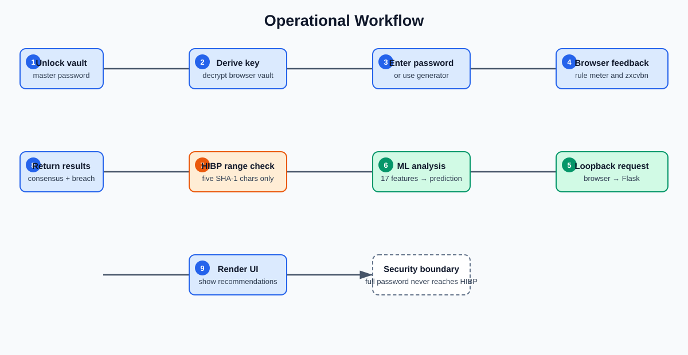

# Secure Password Manager: Strength Analysis and Breach Checking

**Application-Based Cyber Security Project Report**

**Submitted by**

1. Vujja Punith Sai - S20240010260
2. Voorkonda Shivamani Kumar Reddy - S20240010259

**Department of Computer Science and Engineering, IIIT Sri City**

## Abstract

This project studies a browser-based password manager and improves the password feedback available to a user. The implemented vault encrypts entries in the browser using AES-256-GCM. A key is derived from a master password using PBKDF2-HMAC-SHA256 with a random salt and 600,000 iterations. The application also provides password generation, categories, search, automatic locking, a rule-based strength meter, zxcvbn feedback, and a Have I Been Pwned (HIBP) range lookup.

The selected reference article describes a password-manager application but does not explain its strength-analysis algorithm or give experimental model results. Our improvement adds a local machine-learning service and a recommendation engine. The service compares a rule meter, zxcvbn, Random Forest, and XGBoost for weak, medium, and strong password labels. The supplied Kaggle experiment reported 95.83% accuracy and 95.82% macro-F1 for Random Forest on its held-out, source-labelled test split. These values are experimental classification results, not a guarantee of password safety or crack resistance.

**Keywords:** password manager, AES-GCM, PBKDF2, HIBP, Random Forest, XGBoost, password strength

<!-- pagebreak -->

## 1. Introduction

Passwords are still widely used for email, banking, education, and social-media accounts. Reusing a password or choosing a predictable password increases the risk of credential stuffing and guessing attacks. A password manager helps users store unique credentials, but a vault alone does not explain whether a password is common, breached, or easy to guess.

### Background and motivation

The reference paper, *Password Manager* by Kanjikar et al., presents a web password-manager concept with encryption, a master password, generation, categories, search, and strength analysis. Its description is useful as an application baseline. However, it does not specify how strength is calculated and does not publish classifier accuracy, datasets, or test results. Therefore, a direct numerical comparison with the paper is not possible.

### Problem statement

The existing browser implementation used a simple composition-based meter. Length and character classes alone can label predictable choices such as `Password1!` more positively than they deserve. It also did not provide an actionable response when a user entered a weak password.

### Objectives

1. Implement a browser-local password vault based on the selected application area.
2. Compare rule-based feedback, zxcvbn, Random Forest, and XGBoost on the supplied password experiment.
3. Add a breach-exposure check using the HIBP range API.
4. Improve weak-password feedback with a local recommendation engine.
5. Document the limits of the prototype and evaluate the improvement.

<!-- pagebreak -->

## 2. Overview of the Existing Article / Technique

The selected article is M. Kanjikar, A. Yekkele, D. Wale, N. Sharma, and N. Wadikar, “Password Manager,” *International Journal for Research in Applied Science & Engineering Technology*, vol. 13, issue XII, December 2025, pp. 1492-1498.

### Working methodology of the selected approach

The article describes a user unlocking a vault through a master password. A derived key protects stored credentials. The paper mentions AES-256, PBKDF2, a React frontend, backend APIs, a database, password generation, search, categories, automatic locking, and strength analysis. It also mentions future work involving machine learning.

### Advantages and applications

The main advantages are centralised credential storage, generation of unique passwords, search and categorisation, and reduced dependence on human memory. Password managers are useful for personal, academic, and small-team account management.

### Gap identified

The paper does not name a strength algorithm, training data, evaluation protocol, or measured result. It also has an implementation-stack inconsistency: its body describes React/Node/PostgreSQL while its conclusion refers to Python/Flask and SQLite/MySQL. This project treats the paper as a conceptual baseline, not as a source of verified classifier metrics.

<!-- pagebreak -->

## 3. Implementation of the Existing Approach

The baseline application is a React 18, TypeScript, Vite, and Tailwind CSS browser application. Vault entries are encrypted in the browser and saved as ciphertext in `localStorage`. A local email field selects a separate browser-vault namespace; this is not server authentication and no external account is created.

| Component | Implementation used |
|---|---|
| Vault encryption | Web Crypto AES-256-GCM with a fresh 12-byte IV per entry |
| Key derivation | PBKDF2-HMAC-SHA256, random 16-byte salt, 600,000 iterations |
| Vault storage | Encrypted records in browser localStorage |
| Usability | Password generator, add/delete/search/category, five-minute auto-lock |
| Existing feedback | Rule-based composition meter and zxcvbn |

### Experimental setup

The model experiment uses pandas, NumPy, scikit-learn, XGBoost, joblib, and zxcvbn. The supplied Kaggle package contains a feature order, model artifacts, model-comparison CSV, and metadata. The active local service loads the selected artifact and exposes a loopback-only Flask API at `127.0.0.1:5000`.

### Baseline observation

The rule meter is immediate and easy to explain, but it relies largely on length and character classes. It cannot reliably identify dictionary-derived passwords, common numeric patterns, or a breached password. This limitation motivates the proposed approach.

<!-- pagebreak -->

## 4. Challenges and Limitations

The main challenge selected for improvement is that a basic strength meter can warn a user but may not provide useful, evidence-based guidance. A second issue is that a composition-only score cannot distinguish all predictable passwords from genuinely less predictable ones.

| Limitation | Impact |
|---|---|
| Rule meter uses visible character patterns | Can overestimate predictable substitutions and common words |
| No breach lookup in the original baseline | A password can be strong-looking but already exposed |
| Passive warning only | User may not know how to improve a weak password |
| Browser localStorage vault | Same-origin script injection can compromise an unlocked vault |
| ML labels are source-derived | Accuracy is not a measure of real-world crack time |

These limitations matter because a user may trust a green label without understanding its assumptions. In particular, classifier probability is not proof that a password is safe. HIBP results are also incomplete: “no match” only means no match was found in that service’s available corpus.

The prototype has no server-side synchronisation or account recovery. The Node/PostgreSQL code in the repository is a separate scaffold and is not part of the browser-vault flow. The local ML service receives the submitted password in plaintext over loopback, so it must not be exposed to a network and real credentials should not be used during a demonstration.

<!-- pagebreak -->

## 5. Proposed Approach

The proposed improvement combines three signals: a local ML classification result, a HIBP range lookup, and an active recommendation engine. The recommendation engine is shown only when the model result is weak or medium. It preserves useful parts of the user’s pattern, adds CSPRNG-generated content, and returns only candidates that the installed model classifies as Strong with a probability of at least 0.85.

### Proposed workflow

**Figure 1.** Operational workflow of the proposed solution.

The browser runs the rule meter and zxcvbn. For optional ML analysis, it sends the password to the local Flask service only. Flask extracts 17 features and evaluates the selected classifier. For HIBP, Flask computes SHA-1 and sends only the first five hexadecimal characters to the HIBP range endpoint. HIBP never receives the complete password.

### Recommendation logic

The engine parses alphabetic, numeric, and symbol segments. It then tries five mutation strategies: capitalise-and-extend, leet-and-insert, prefix injection, segment shuffle, and full remix. Python’s `secrets` module generates random additions. The design is intended to make a weak-password warning actionable; it is not a replacement for a password generator.

<!-- pagebreak -->

## 6. Implementation of the Proposed Approach

The Flask service provides `/api/analyze` and `/api/recommend`. The analysis endpoint returns rule-based, zxcvbn, ML, HIBP, and consensus data. The consensus is Weak if HIBP reports a breach or if the ML model labels the password weak. It is Strong only when both the ML model and zxcvbn label it strong; otherwise it is Medium. If the model is unavailable, the UI falls back to zxcvbn and clearly indicates that ML is unavailable.

The frontend adds a colored consensus badge, masked recommendation cards, Show/Hide controls, and Copy buttons. To prevent misleading output, an exact model probability of 1.0 is displayed as “very high (>=99%) model probability,” not as a claim of perfect security.

**Figure 2.** Implemented architecture and trust boundaries.

The application also includes a local-only demo profile for presentation. A Gmail/email field and master-password field open a separate browser-local vault. The displayed demo credentials create or open only this local profile; they do not authenticate with Gmail or an external server.

<!-- pagebreak -->

## 7. Results and Analysis

The supplied Kaggle model package reports the following result on its own 15,000-row balanced held-out split. Common-password lists contribute source-labelled weak examples, so the result measures agreement with that experiment’s labels rather than empirical attacker crack time.

| Method | Accuracy (%) | Macro-F1 (%) |
|---|---:|---:|
| Existing app rule meter | 69.45 | 62.63 |
| zxcvbn | 84.29 | 84.19 |
| Random Forest | **95.83** | **95.82** |
| XGBoost | 86.65 | 86.07 |

**Figure 3.** Comparison chart generated locally from the available evaluation data.

### Observations

Random Forest was selected for the local service because it had the highest archived macro-F1 in the supplied bundle. The UI does not display XGBoost inference simultaneously; XGBoost is a comparison model in the experiment. The system successfully returns three model-validated suggestions for weak test inputs and includes breach status in the final verdict. This addresses the selected usability limitation because the user receives a next action, not only a warning.

The result should be interpreted carefully. The retrained local experiment produced strong clean-test values, but near-perfect internal-split values can be inflated by label construction or source overlap. For the report, the supplied 95.83% / 95.82% result is retained as the archived experiment result.

<!-- pagebreak -->

## 8. Conclusion

This work implemented a browser-based password-manager prototype and used the selected paper as an application-level starting point. The existing approach was reproduced as a local encrypted vault with generation, search, categories, auto-lock, and basic strength feedback. The important limitation identified was that simple password feedback is often passive and pattern-based.

The proposed solution adds data-driven classification, breach exposure checking, a consensus verdict, and a local recommendation engine. The supplied experiment shows that Random Forest performed better than the other compared approaches on its source-labelled held-out data. The recommendation panel makes the result more useful by generating alternatives rather than only reporting “weak.”

The project is appropriate as an academic prototype, but not as a production password manager. Future work should include rate limiting for the recommendation endpoint, a reviewed content-security policy, encrypted backup/export, model calibration, a separate validation set for model selection, and a server-side design only after a proper threat model is defined.

## 9. References

1. M. Kanjikar et al., “Password Manager,” *IJRASET*, vol. 13, issue XII, pp. 1492-1498, Dec. 2025. DOI: 10.22214/ijraset.2025.76363.
2. D. L. Wheeler, “zxcvbn: Low-Budget Password Strength Estimation,” *USENIX Security Symposium*, 2016.
3. Have I Been Pwned, “Pwned Passwords API.” https://haveibeenpwned.com/API/v3#PwnedPasswords
4. OWASP Foundation, “Password Storage Cheat Sheet.” https://cheatsheetseries.owasp.org/cheatsheets/Password_Storage_Cheat_Sheet.html
5. Kaggle datasets used in the experiment: Password Strength Classifier, RockYou common-password list, 10,000 Most Common Passwords, and Top 10 Million Passwords.

## Appendix: Demonstration Checklist

1. Start `python serve_model.py` and confirm `/health` reports `model_loaded: true`.
2. Start the Vite client and open the local application.
3. Use the local demo profile or create a new local vault using the email and master-password fields.
4. Add a fake credential only; do not enter a real account password.
5. Enter a weak test password such as `demo123` and show the rule meter, zxcvbn, ML badge, HIBP status, and recommendations.
6. Enter a strong generated password and show that recommendations are not needed.
7. Explain that HIBP receives only a five-character SHA-1 prefix and that the full password reaches only the loopback service during optional ML analysis.

**Important:** The demo profile is local browser data, not an online Gmail account. Clear browser site data only if the test vault is no longer needed.
