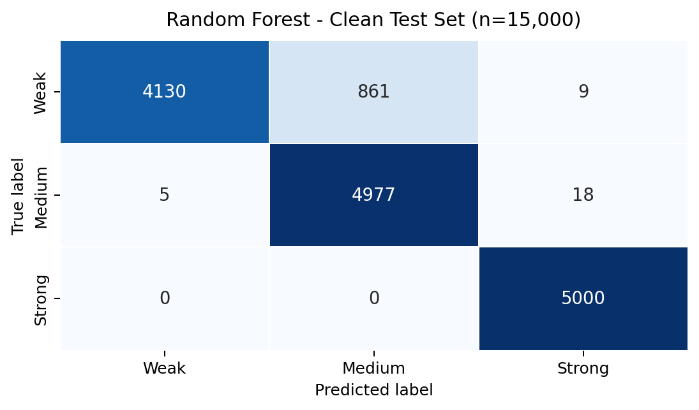

# Secure Password Manager

**Password-strength analysis, breach checking, and actionable recommendations**

**Application-Based Cyber Security Project Report**

**Submitted by**

1. Vujja Punith Sai - S20240010260
2. Voorkonda Shivamani Kumar Reddy - S20240010259

**Department of Computer Science and Engineering, IIIT Sri City**

## Abstract

This project implements a browser-based password-manager prototype and evaluates an improvement to its password-strength feedback. The vault encrypts entries locally with AES-256-GCM. A master password is processed with PBKDF2-HMAC-SHA256 using a random salt and 600,000 iterations. The application includes password generation, search, categories, automatic locking, a composition-based rule meter, zxcvbn feedback, and a Have I Been Pwned (HIBP) range lookup.

The identified limitation is that composition-only feedback can overestimate predictable passwords and gives users little help after a weak result. The proposed approach adds a loopback-only machine-learning service, a breach-aware consensus verdict, and recommendation generation. All reported model values use one reproducible clean test set of 15,000 labelled passwords, balanced across weak, medium, and strong classes. Random Forest achieved 94.05% accuracy and 94.00% macro-F1 on that test set, outperforming the other evaluated approaches. These are classification results on source-derived labels; they do not measure real-world crack time or guarantee password safety.

**Keywords:** password manager, AES-GCM, PBKDF2, password strength, HIBP, Random Forest, XGBoost

### Project at a glance

| Area | Main contribution |
|---|---|
| Existing approach | Browser-local encrypted vault with generation, search, categories, and auto-lock |
| Identified challenge | Composition-only feedback can overestimate predictable passwords |
| Proposed improvement | Local ML analysis, HIBP breach checking, consensus, and recommendations |
| Evaluation basis | One clean, balanced 15,000-password test set used for every reported model metric |

The project deliberately separates vault protection from password assessment. Encryption protects stored entries, while strength analysis helps a user choose a safer password before storing it. Both controls are needed: a well-encrypted vault cannot make a weak reused password safe, and a strong password cannot compensate for unprotected storage.

<!-- pagebreak -->

## 1. Introduction

Passwords remain common for email, education, banking, and social-media accounts. Weak or reused passwords support credential stuffing, online guessing, and account takeover. A password manager reduces reuse by making unique credentials practical, but its security feedback must be meaningful: a password that satisfies character rules can still be common or predictable.

### Background and motivation

The reference article, *Password Manager* by Kanjikar et al., describes a password-manager application with encryption, a master password, generation, categories, search, and strength analysis. It is a useful application baseline, but it does not specify the strength algorithm, dataset, evaluation procedure, or classifier metrics. This project therefore implements the application area and evaluates a clearly defined improvement rather than attributing model results to the article.

### Problem statement

The baseline rule meter primarily rewards length and character classes. It can give a favourable result to a predictable construction such as `Password1!`, and it does not directly tell a user what to do after a weak result.

### Cyber-security relevance and scope

The protected assets are stored credential entries and the master password used to unlock them. The prototype is designed to reduce routine risks such as password reuse and weak-password selection. It does not claim to defend against malware running with the user's privileges, a malicious browser extension, phishing, or a compromised device. Defining this boundary keeps the evaluation focused on the implemented controls rather than overstating the system's protection.

The project evaluates password-strength classification and feedback quality, not user adoption or real attacker crack time. The practical success criterion is that a weak or medium password receives a conservative verdict and a safer next action without exposing the complete password to the HIBP service.

### Objectives

1. Implement a browser-local encrypted credential vault.
2. Compare the rule meter, zxcvbn, Random Forest, and XGBoost on one fixed test set.
3. Add password-exposure checking through the HIBP range API.
4. Provide local, model-validated recommendations for weak or medium passwords.
5. Document the security limits of the prototype and assess the improvement.

<!-- pagebreak -->

## 2. Overview of the Existing Article / Technique

The selected article is M. Kanjikar, A. Yekkele, D. Wale, N. Sharma, and N. Wadikar, "Password Manager," *International Journal for Research in Applied Science & Engineering Technology*, vol. 13, issue XII, December 2025, pp. 1492-1498.

### Working methodology

The article describes unlocking a vault with a master password, deriving a key, encrypting stored credentials, and providing password generation, categories, search, automatic locking, and strength feedback. It presents the password manager as a usability tool that helps a user retain unique credentials rather than memorising each one.

### Advantages and applications

The approach centralises credential storage, supports password generation, and reduces password reuse. It is relevant to personal, academic, and small-team credential management when implemented with an appropriate threat model.

### Gap selected for this project

The article does not identify its strength algorithm or publish a dataset, test protocol, or measured strength-classification result. It also describes more than one implementation stack. For these reasons, the article is used as a conceptual baseline only. The improvement in this report is evaluated with repository artifacts and a documented, repeatable test set.

### Baseline data flow

| Step | Baseline action | Security purpose |
|---|---|---|
| 1 | User supplies a master password | Establishes local vault access |
| 2 | PBKDF2 derives an encryption key | Makes direct storage of the master password unnecessary |
| 3 | AES-GCM decrypts or encrypts entries | Protects credential confidentiality and detects tampering |
| 4 | Rule meter scores password composition | Gives immediate but limited feedback |
| 5 | Encrypted vault data is stored locally | Supports offline browser-based use |

The proposed work retains these vault functions and improves Step 4 with additional evidence. This is a controlled comparison: the core local-vault design is unchanged while password assessment and feedback are extended.

### What the baseline does and does not decide

The baseline can state whether a password has length, uppercase, lowercase, digit, and symbol characteristics. It cannot determine whether the password was exposed in a breach, whether it is a common phrase with substitutions, or whether another person can guess it easily. This distinction is central to the project: the proposed method improves feedback quality, while the encryption design continues to protect the stored vault separately.

<!-- pagebreak -->

## 3. Implementation of the Existing Approach

The baseline is implemented as a React 18, TypeScript, Vite, and Tailwind CSS browser application. Each local email identifier selects a separate encrypted browser-vault namespace. This is local profile selection, not server authentication, and it does not create an external email account.

| Component | Implementation used |
|---|---|
| Vault encryption | Web Crypto AES-256-GCM with a fresh 12-byte IV per encrypted record |
| Key derivation | PBKDF2-HMAC-SHA256, random 16-byte salt, 600,000 iterations |
| Storage | Ciphertext and vault metadata in browser localStorage |
| Vault functions | Password generator, add/delete/search/category, five-minute auto-lock |
| Existing feedback | Composition rule meter and zxcvbn estimation |

### Encryption and key lifecycle

The master password is used as input to PBKDF2; it is not stored as a plaintext vault value. PBKDF2 combines the master password with a random salt and a high iteration count to derive an AES key. Each encrypted record uses a fresh initialization vector, which prevents identical input records from producing the same ciphertext. AES-GCM additionally provides authenticated encryption, so a modified encrypted record can be detected during decryption.

When the user locks the vault, the in-memory unlock state is cleared. The browser storage retains only encrypted vault data and the metadata needed for later key derivation. This local-only implementation improves demonstration privacy but does not replace endpoint security: an attacker who controls the browser context while the vault is unlocked can still access displayed information.

### Experimental environment

The proposed model service uses Python, Flask, pandas, NumPy, scikit-learn, XGBoost, joblib, and zxcvbn. It binds to `127.0.0.1:5000` so that optional analysis stays on the demonstration device. The active service selects the Random Forest artifact because it had the best macro-F1 on the verified clean test set.

### Baseline limitation

The rule meter is immediate and easy to explain, but it considers visible composition rather than whether a password resembles a known word, sequence, or common pattern. It is a useful baseline, not a complete security decision.

### Implementation scope for demonstration

The demonstration uses synthetic credentials only. The local email field separates browser vaults for testing, but it is not an online login system and does not send data to Gmail or another identity provider. Optional model analysis is limited to the loopback Flask service. The only external check is HIBP's range API, which receives a five-character SHA-1 prefix rather than the full password.

<!-- pagebreak -->

## 4. Challenges and Limitations

| Identified limitation | Security or usability impact | Improvement implemented |
|---|---|---|
| Rule meter uses visible patterns | Predictable substitutions can be overestimated | ML classification and zxcvbn comparison |
| No breach signal in the baseline | A strong-looking password may already be exposed | HIBP k-anonymity range lookup |
| Passive weak warning | User may not know how to improve it | Recommendation engine for weak/medium results |
| Browser-local vault | Same-origin script injection can affect an unlocked vault | Documented local-only scope and auto-lock |

These limitations are important because a user can mistake a positive visual score for a security guarantee. A classifier can also inherit bias from its labels, and a breach lookup cannot prove that a password is safe when no match is returned. The prototype therefore uses a conservative verdict and describes its limits instead of presenting any single signal as final proof.

The local-vault design has additional scope limits. It does not provide cloud synchronisation, recovery, multi-device access, or protection against malware on an unlocked device. These omissions are deliberate for a browser-local academic prototype and are included in the future-work plan.

<!-- pagebreak -->

## 5. Proposed Approach

The improvement combines three independent signals: rule and zxcvbn feedback in the browser, a machine-learning prediction from a local Flask service, and breach exposure from HIBP. The final consensus is Weak when a breach is reported or the model labels the password weak. It is Strong only when both the model and zxcvbn label the password strong; otherwise it is Medium.

The recommendation engine is invoked only for weak or medium results. It applies controlled mutations such as extending a phrase, adding cryptographically random content, and remixing segments. A candidate is returned only if the installed model labels it Strong with probability at least 0.85. This feature gives the user a next action; it does not replace the password generator.

### Proposed workflow and security boundaries

**Figure 1.** Operational workflow of the proposed solution.

The browser performs rule and zxcvbn feedback immediately. If analysis is requested, the full password is sent only to the loopback Flask service. Flask extracts 17 features and evaluates the active model. For the HIBP check, Flask hashes the password with SHA-1 and sends only the first five hexadecimal characters to the HIBP range endpoint. The suffixes returned by HIBP are compared locally; the full password is never sent to HIBP.

### Security assumptions and limits

The application is a classroom prototype, not a production password manager. It has no server-side synchronisation, recovery mechanism, or independently audited browser hardening. Real credentials should never be entered during a demonstration. Model probabilities are treated as ranking information, not as a guarantee of security.

<!-- pagebreak -->

## 6. Implementation of the Proposed Approach

The Flask service exposes `/api/analyze` and `/api/recommend`. The analysis endpoint returns the local rule result, zxcvbn result, ML label, HIBP status, and consensus verdict. If the model service is unavailable, the interface falls back to zxcvbn and states that ML analysis is unavailable.

**Figure 2.** Implemented architecture and trust boundaries.

The user interface presents only decision-relevant information: the overall verdict, breach status, brief feedback, and recommendations when applicable. It does not treat an exact probability as a security promise, and presentation-only controls are excluded from this report.

### Service responsibilities and failure handling

| Local endpoint | Purpose | Important behaviour |
|---|---|---|
| `/health` | Confirms the local service and selected model are available | Returns status only; no password input is needed |
| `/api/analyze` | Produces rule, zxcvbn, ML, HIBP, and consensus results | Password is handled only for the current loopback request and is not stored |
| `/api/recommend` | Produces stronger alternatives for weak or medium input | Uses `secrets` for random additions and validates candidates with the active model |

If the local model service is not running, the application still provides browser-side zxcvbn feedback and states that ML analysis is unavailable. This fallback prevents the interface from silently presenting an incomplete result as a full security assessment. The HIBP check is treated separately: an unavailable external lookup is shown as unavailable rather than as a clean breach result.

<!-- pagebreak -->

## 7. Results and Analysis

### Evaluation protocol

All metrics and figures in this section use the same clean test set: 15,000 labelled passwords, with 5,000 weak, 5,000 medium, and 5,000 strong samples. Accuracy and macro-F1 are reported because macro-F1 weights each class equally. The values below were recomputed from the active repository model artifacts with the fixed feature set and labels.

| Method | Accuracy (%) | Macro-F1 (%) |
|---|---:|---:|
| Existing rule meter | 69.42 | 62.91 |
| zxcvbn | 84.81 | 84.65 |
| Random Forest | **94.05** | **94.00** |
| XGBoost | 89.65 | 89.40 |

**Figure 3.** Clean-test comparison of the four evaluated approaches.

### Interpretation

Random Forest is the active local model because it achieved the highest macro-F1 (94.00%) on the common evaluation set. The result is an improvement of 31.09 percentage points in macro-F1 over the rule meter. XGBoost is retained as a comparison model, not displayed as a simultaneous inference result. The outcome supports the selected improvement: the system can supplement a basic rule meter with a better-performing classifier, breach information, and an actionable recommendation.

<!-- pagebreak -->

## 7. Results and Analysis (continued)

**Figure 4.** Random Forest confusion matrix. Rows are true labels; columns are predictions.

The model correctly identified all 5,000 strong samples and 4,977 of 5,000 medium samples. Most errors are weak passwords predicted as medium (861 cases). This is the important residual risk: the application must not rely on the classifier alone. The consensus logic and HIBP lookup provide additional signals, while the password generator remains the preferred route for creating a new credential.

## 8. Conclusion

This project implemented a browser-local password-manager prototype and addressed a specific limitation of composition-only password feedback. The proposed design adds local ML analysis, HIBP breach checking, a conservative consensus verdict, and recommendation generation. On one documented clean test set, Random Forest was the strongest evaluated method at 94.05% accuracy and 94.00% macro-F1.

The result is useful for this prototype but should not be interpreted as a crack-time estimate or proof of production readiness. Future work should add model calibration, a separate validation set for model selection, recommendation rate limiting, a reviewed content-security policy, encrypted backup/export, and a formal threat model before any server-side synchronisation is introduced.

## 9. References

1. M. Kanjikar et al., "Password Manager," *IJRASET*, vol. 13, issue XII, pp. 1492-1498, Dec. 2025. DOI: 10.22214/ijraset.2025.76363.
2. D. L. Wheeler, "zxcvbn: Low-Budget Password Strength Estimation," *USENIX Security Symposium*, 2016.
3. Have I Been Pwned, "Pwned Passwords API." https://haveibeenpwned.com/API/v3#PwnedPasswords
4. OWASP Foundation, "Password Storage Cheat Sheet." https://cheatsheetseries.owasp.org/cheatsheets/Password_Storage_Cheat_Sheet.html
5. Kaggle data sources used by the repository: Password Strength Classifier, RockYou common-password list, 10,000 Most Common Passwords, and Top 10 Million Passwords.
